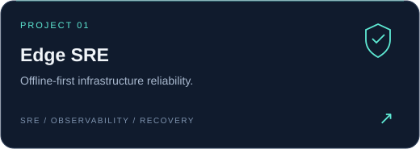
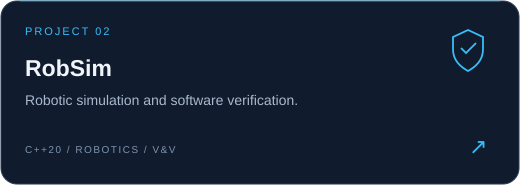
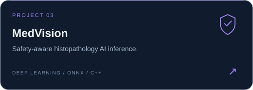
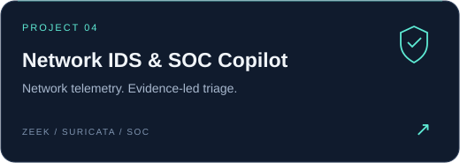
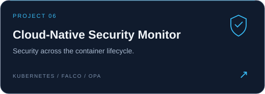
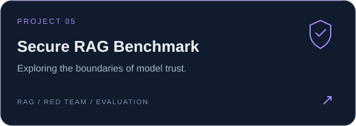
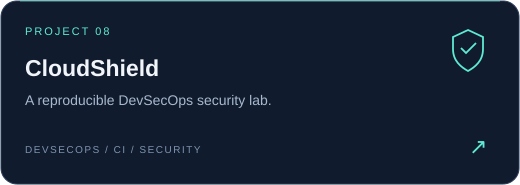
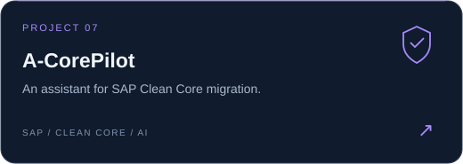

  
    
  <a href="mailto:louay.hammoudi@etudiant-enit.utm.tn"><strong>Get in touch ↗</strong></a>
  &nbsp;&nbsp;·&nbsp;&nbsp;
  <a href="https://github.com/LouayHM3?tab=repositories"><strong>Explore my work ↗</strong></a>
    
  AI &amp; cybersecurity &nbsp;/&nbsp; cloud infrastructure &nbsp;/&nbsp; networks

 

## A little about me

I'm **Louay**, a final-year **ICT Engineering student at ENIT**, studying **Telecommunications & Networks** and specializing in **Converged Infrastructures, Cloud & Cybersecurity (I3C)** from September 2026. Alongside my engineering degree, I'm pursuing a concurrent **Master’s programme in Information Systems Techniques (IST)**. I'm based in **Tunis, Tunisia**.

I build projects at the intersection of cybersecurity, AI/LLMs, networked systems and secure automation: from RAG evaluation and SOC tooling to cloud infrastructure, software verification and network observability.

- **Currently exploring** — LLM security, retrieval-grounded assistants, agentic workflows and reliable autonomous systems.
- **Engineering interests** — security automation, distributed systems, DevSecOps, robotics verification and applied machine learning.
- **Beyond the keyboard** — two-time Tunisian national taekwondo champion and former national-team member.

## Experience & research

| Experience | Work |
| :--- | :--- |
| **Sopra Steria · AI & Cybersecurity Intern · Dec 2025–May 2026** | Developed NovaGuard AI for centralized monitoring and auditing of distributed ModSecurity WAF configurations, using RAG to connect alerts, configurations and technical documentation. |
| **AYMAX · AI & Enterprise Software Intern · Jun–Aug 2026** | Built a VS Code multi-agent assistant for SAP Clean Core modernization and legacy-code analysis; connected RAG/LLM workflows to ABAP RAP, CDS Views, OData and Fiori Elements. |
| **SORECI · Digital Transformation Intern · Summer 2025** | Supported network/system administration, infrastructure troubleshooting, optimization and AWS cloud-migration activities. |
| **Louati Construction · Web Developer & AI Tools Database Engineer · Apr–May 2025** | Built a real-time project-tracking dashboard and structured task data, with AI-assisted delivery-risk analysis and assignment optimization. |
| **ENIT Junior Enterprise · Web Developer · 2024–present** | Developed Next.js websites, backend logic, APIs and custom client tools for clients. |
| **Tagourti Car Company · Data, AI & IoT Intern · Summer 2024** | Designed vehicle, customer and sales data structures and built a car recommendation and fair-price estimation tool. |

**Research manuscript in preparation:** RAG and LLM workflows for ModSecurity alert/configuration analysis and security-rule engineering, with **Dr. Ines Bouzouiuta**.

**Applied cybersecurity research:** controlled penetration-testing laboratory with **Dr. Hamza Hammami**, using Kali Linux, Metasploit, Armitage and VirtualBox to study reproducible attack scenarios and defensive hardening.

 

## Selected projects

Projects from my starred repositories. Click a card or project link to explore its source, architecture and implementation.

**Starred projects:** [Edge SRE](https://github.com/LouayHM3/EDGE-SRE) · [RobSim](https://github.com/LouayHM3/RobSim) · [MedVision](https://github.com/LouayHM3/Breast-Cancer-Histopathology-Classification-with-Deep-Learning) · [Network IDS & SOC Copilot](https://github.com/LouayHM3/network-ids-soc-copilot) · [Secure RAG Red-Team Benchmark](https://github.com/LouayHM3/secure-rag-red-team-benchmark) · [Cloud-Native Security Monitor](https://github.com/LouayHM3/cloud-native-security-monitor) · [A-CorePilot](https://github.com/LouayHM3/A-CorePilot) · [CloudShield](https://github.com/LouayHM3/CloudShield)

  
  
  
  
  
  
  
  

 

## My toolkit

| Focus | Skills from my CV |
| :--- | :--- |
| **Programming** | Python · C++20 · C · C# · Java · JavaScript · Embedded C · SQL · Node.js · Express · Solidity |
| **C++ & algorithms** | Concepts/ranges · Templates · STL · CMake · RAII/smart pointers · AVL trees · Hashing · Heaps · Graph algorithms |
| **AI & GenAI** | ML/DL · NLP · RAG · Agent orchestration · Prompt chains · LLM evaluation & red teaming · TensorFlow/Keras · PyTorch · scikit-learn · Hugging Face · Embeddings · Vector databases · Grad-CAM · ONNX/ONNX Runtime · OpenCV |
| **Software V&V & robotics** | C++20 software-in-the-loop simulation · PID control · Actuator/sensor modelling · Fault injection · Automated verification · Metrics/reports · YAML scenarios · GitHub Actions CI |
| **Cybersecurity, privacy & networks** | TCP/IP · Routing · Linux administration · SOC · WAF · SIEM · ModSecurity · Zeek · Suricata · MITRE ATT&CK · Penetration testing · MQTT · Role/context-based access control · Pseudonymization · Audit logging |
| **Cloud, DevSecOps & SRE** | AWS: EC2, S3, Lambda, RDS · Docker · Kubernetes · OpenSearch · Trivy · Falco · OPA · Prometheus · Grafana · Git · Observability · Incident triage · Policy-gated remediation design |
| **Scientific computing & RF** | Numerical modelling · Particle Swarm Optimization · Reinforcement learning · MDPs · Dynamic Programming · Monte Carlo · SARSA · Q-learning · RF systems · Signal processing · STFT/spectrograms · Wireless sensor networks |
| **SAP & enterprise** | SAP Clean Core · ABAP RAP · CDS Views · OData · Fiori Elements · Legacy-code analysis · Governance checks |
| **Embedded systems & data** | STM32 · RTOS · Arduino · Raspberry Pi · PostgreSQL · MySQL · MongoDB · Streamlit · NumPy · SciPy · PyWavelets · Matplotlib |

**Concept familiarity:** BabyAGI, ChatDev and AgentFramework.

## Certifications, languages & community

- **Certifications & training:** Cisco CCNA; AWS Academy Cloud Foundations, Developing and Operations; Linux Administration; CTF Architecture.
- **Languages:** Arabic (native), French (C1), English (C1), German (A2).
- **Community:** Sécurinets Club CTF organization and Linux/exploit-development training.
- **Applied projects:** STM32/TensorFlow Lite on-device inference, OpenCV/MQTT sensing prototypes, and vehicle-data modelling, recommendations and fair-price estimation for Tagourti Car Company.

 

  <h3>Let's build something worth trusting.</h3>
  
Interested in AI, cybersecurity, cloud or network engineering? I'd be happy to connect.

  
<a href="mailto:louay.hammoudi@etudiant-enit.utm.tn"><strong>louay.hammoudi@etudiant-enit.utm.tn ↗</strong></a>

   
  Built with curiosity. Improved through practice.

